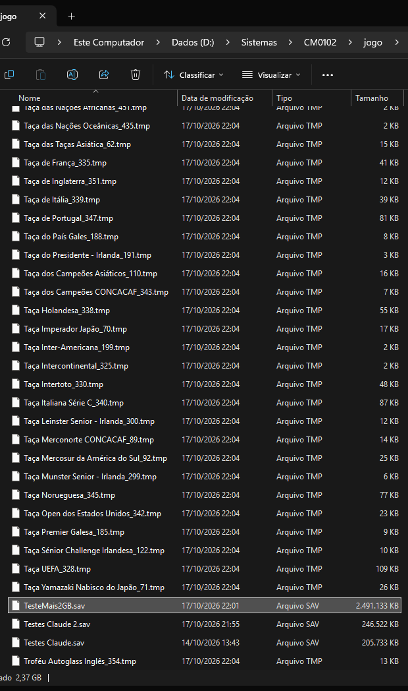
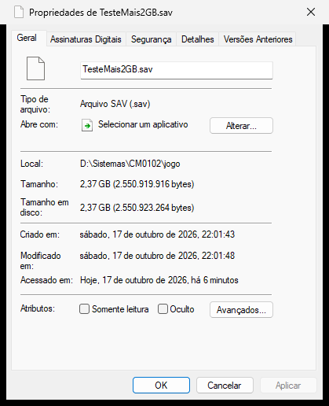

# Saves acima de 2 GB (até 4 GB)

Correção do CM 01/02 3.9.68 para carreiras cujo save passa de 2 GB. Feita na 158ª leva (17/10/2026) e distribuída de duas formas:
- dentro da `ddraw.dll` do projeto CM 01/02 em Rust (repositório privado);
- numa **DLL só do save** (este repositório, release `save2gb-1.0.zip`), feita para os exes modificados (NickPatcher, CLZ e outros).

## O problema

Com o save acima de 2 GB, o jogo não carrega mais a carreira. Aparece uma caixa de erro com o arquivo de código da parte que estava sendo lida, como `comp_stats.cpp 6000/6007` ou `Friendly.cpp`, e o carregamento trava.

A saída que circulava no fórum era mover arquivos `.tmp` à mão. Ela deixa de ser necessária.

## A causa

O `.sav` (e o `.qst` do início rápido) é um contêiner próprio da SI, `si/code/zipdir.cpp`:

| Trecho | Conteúdo |
|---|---|
| bytes 0–11 | tipo (3 = sem compressão, 4 = RLE; os antigos 1/2 viram 3/4), versão, quantidade de itens |
| a partir do byte 12 | índice: até 1000 itens de 0x10c bytes = posição (u32), tamanho (u32), nome (260 bytes) |
| depois | os dados de cada item, um atrás do outro |

O índice guarda as posições em **32 bits sem sinal**, que vão até 4 GB. Quem não comporta é o código: três rotinas usam o `fseek`/`ftell` da CRT, de **32 bits com sinal**, que só vão até 2 GB.

| Rotina | Endereço | O que dá errado acima de 2 GB |
|---|---|---|
| `zopen` | 0x9326e0 | ao gravar, `fseek(fim)` + `ftell` devolve −1: o item ganha a posição 0xFFFFFFFF no índice e o save já sai estragado; ao ler, `fseek(posição)` com sinal falha |
| `zseek` | 0x933080 | compara posições com sinal e busca com `fseek` de 32 bits |
| `ztell` | 0x933170 | `ftell` de 32 bits |

As outras funções do contêiner (`zread` 0x932c30, `zwrite` 0x932e10, `zclose` 0x932b00, empacotar 0x933610, desempacotar 0x933320) leem e gravam em sequência, ou só voltam ao começo do arquivo, e não precisam de correção. As funções da CRT `_findfirst` e `GetDiskFreeSpace` também não limitam o save.

## A correção

As três rotinas foram reescritas em Rust (`src/conteiner.rs`):
- posições tratadas como sem sinal;
- busca e posição pelo `SetFilePointer` do Windows, com a parte alta de 64 bits, repetindo o que o `fseek`/`ftell` da CRT fazem com o `FILE`: esvaziar o buffer, marcas de leitura e escrita, fim de arquivo na tabela de arquivos, desconto do buffer na posição;
- **o formato não muda**: um save de até 2 GB gravado com a correção abre num jogo sem ela;
- **acima de 4 GB**, o item é recusado como se o contêiner estivesse cheio, com uma linha no registro, sem estragar o arquivo. Um formato estendido fica para depois.

## A DLL só do save

A release traz uma `ddraw.dll` de ~190 KB.

**Instalar:**
1. Copie a `ddraw.dll` para a pasta do exe do jogo.
2. Pronto: o exe não é alterado.

**Remover:** apague a `ddraw.dll`.

**O que ela faz ao carregar:**
1. Calcula a assinatura (FNV-1a de 64 bits) do código de que depende: o contêiner inteiro (0x9326e0–0x933860) e o começo de 14 funções da CRT e do jogo que as rotinas chamam.
2. Se a assinatura for a do 3.9.68 (`232589cfe29f6240`), troca a entrada das três rotinas por um salto para as versões em Rust e grava "ligado" no `save2gb.log`.
3. Se não for, **não altera nada** e grava a assinatura encontrada no `save2gb.log`.
4. O `DirectDrawCreate`, a única função que o exe importa da `ddraw.dll`, é repassado à `ddraw.dll` do Windows.

**Outro wrapper de vídeo** (dgVoodoo, cnc-ddraw etc.): renomeie a `ddraw.dll` dele para `ddraw_chain.dll`, na mesma pasta. A nossa repassa para ela.

**Conferência:** `python tools/assinatura_save.py <exe>` (precisa de `pip install pefile`) mostra a assinatura de um exe. Resultados:

| Exe | Assinatura | A DLL age? |
|---|---|---|
| `cm0102.exe` 3.9.68 e as cópias portátil e 1080 do projeto | 232589cfe29f6240 | sim |
| CLZ Leagues Patch (DB 25-26) V5.4, com NickPatcher: `cm0102.exe` e "Tema Black" | 232589cfe29f6240 | sim |
| `cm0102_GDI.exe` 3.9.68 | c7f8f4659479ddda | não: os endereços do exe GDI são outros, e ele nem carrega a `ddraw.dll` |

## Para quem mantém patches

Há três formas de integrar:
1. **Distribuir a DLL como está**, junto do patch.
2. **Carregar a DLL de dentro do seu código.** O desvio acontece no carregamento, seja qual for o nome do arquivo. Renomeie para, por exemplo, `save2gb.dll` e chame `LoadLibrary("save2gb.dll")` da sua DLL, como a `NickDLL`. Nesse caso o `DirectDrawCreate` dela não é usado.
3. **Reescrever as três rotinas no seu código**, com a descrição acima e `src/conteiner.rs` como referência: no `fseek`/`ftell`, troque o `long` por posição sem sinal e use 64 bits.

Se o seu patch altera bytes em 0x9326e0–0x933860, a assinatura não bate e a DLL fica inerte. Nesse caso, fale com a gente.

## Como testar

O save leva junto todos os `*.tmp` da pasta do jogo, em ordem de nome. Um arquivo grande com nome que vem primeiro empurra o resto para além de 2 GB:
1. Com a carreira carregada, crie o enchimento: `python tools/enchimento.py <pasta do jogo> 2200`, que cria `0000_enchimento.tmp` com 2,2 GB. Ele tem de ser criado depois de carregar, porque o jogo apaga os `.tmp` ao carregar e ao criar uma carreira.
2. Salve com outro nome e carregue esse save: com a correção, abre.
3. Sem a correção, o carregamento do mesmo save falha.
4. Apague o enchimento: `python tools/enchimento.py <pasta do jogo> --apagar`.


Resultados de 17/10/2026:
- **save de 2,55 GB**, com 187 itens além de 2 GB: carregou com a correção; sem ela, erro `Friendly.cpp`;
- **`.qst` de 2,38 GB:** a original grava 0xFFFFFFFF nas posições além de 2 GB, e com a correção o índice sai certo.

### As provas

O save de teste de 2,55 GB na pasta do jogo (o `TesteMais2GB.sav`, ao lado de saves normais de 200–250 MB) e as suas propriedades no Windows:





O índice desse save, lido de fora do jogo: as posições passam de 2 GB e seguem em sequência até o fim do arquivo. Embaixo, o mesmo ponto num `.qst` gravado pela original, com a posição estragada:

```
TesteMais2GB.sav: 2,550,919,916 bytes, tipo 3, 249 itens, 187 alem de 2 GB, indice OK
   posicao        tamanho  nome
  2,481,211,007     23,513  1ª Divisão Alemã_16.tmp
  2,481,234,520     29,385  1ª Divisão Argentina_63.tmp
  2,481,263,905     21,848  1ª Divisão Belga_0.tmp
  ...
.qst gravado pela original (sem a correção):
  0000_enchimento.tmp termina em 0x8bc3cf3c, 1ª Divisão Inglesa_8.tmp começa em 0xffffffff
```
